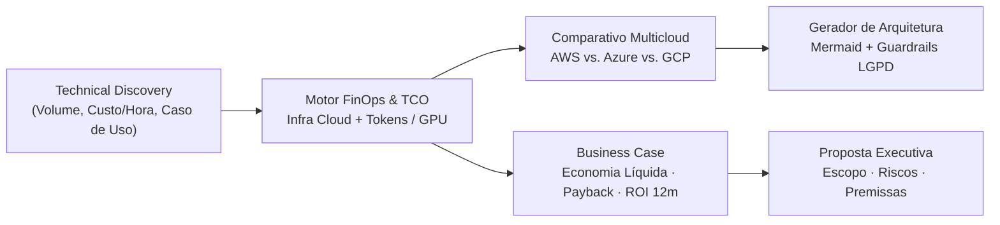

# Cloud & AI Architecture, FinOps & ROI Pre-Sales Studio

[](https://www.python.org/)
[](https://fastapi.tiangolo.com/)
[](#comparativo-multicloud)
[](./LICENSE)

> **Ferramenta Interativa de Pré-Vendas Técnicas & Arquitetura de Soluções:** compara **AWS, Azure e GCP** + **Build vs. Managed LLMs**, calcula **TCO (12 meses), Economia Líquida, Payback e ROI**, e gera automaticamente **Diagrama de Arquitetura (Mermaid)** e **Proposta Executiva** (Escopo, Riscos e Premissas).

---

## Problema de Negócio Resolvido

Em ciclos de pré-vendas B2B de **Cloud e IA Generativa**, CFOs e diretores travam propostas técnicas por 3 motivos recorrentes:
1. **Falta de clareza de FinOps/TCO:** quanto custará manter tokens + infraestrutura no mês 1 e no mês 12?
2. **Dúvida entre Build vs. Managed:** vale subir GPU dedicada (self-hosted) ou usar serviço gerenciado (`AWS Bedrock`, `Azure AI Foundry`, `Vertex AI`)?
3. **Desalinhamento de Escopo e Riscos:** propostas sem premissas explícitas geram atrito no *Handover para Delivery*.

Este estúdio padroniza a conversa técnica e financeira em segundos durante reuniões de **Technical Discovery** e defesa de **Business Case**.

---

## Fluxo de Decisão Arquitetural



---

## Comparativo Multicloud & Build vs. Managed

| Provedor | Compute | Serviço de IA | Banco de Dados |
| :--- | :--- | :--- | :--- |
| **AWS** | ECS Fargate / Lambda | AWS Bedrock | Amazon RDS PostgreSQL + pgvector |
| **Azure** | Azure Container Apps | Azure AI Foundry / OpenAI | Azure Database for PostgreSQL |
| **GCP** | Cloud Run | Vertex AI (Gemini) | Cloud SQL PostgreSQL |

> **Decisão Arquitetural Documentada:** veja [docs/ADR-001-finops-tco-model.md](./docs/ADR-001-finops-tco-model.md) para as premissas de modelagem FinOps e o ponto de equilíbrio entre modelos gerenciados vs. GPU self-hosted.

---

## Quickstart (30 segundos)

### Localmente (Python 3.11+)
```bash
git clone https://github.com/GabrielPVCau/cloud-ai-architecture-roi-studio.git
cd cloud-ai-architecture-roi-studio
pip install -r requirements.txt
uvicorn app.main:app --reload --port 8001
```
Acesse o simulador em `http://localhost:8001` (ou Swagger em `http://localhost:8001/docs`).

### Via Docker Compose
```bash
docker compose up --build
```

### Testes Automatizados (`pytest`)
```bash
pytest -v
```

---

## Autor

**Gabriel Cau** — Arquiteto de Soluções & Pré-Vendas Técnicas (IA, Cloud & APIs)  
[LinkedIn](https://www.linkedin.com/in/gabrielcau/) · [GitHub](https://github.com/GabrielPVCau)
